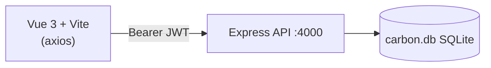

<div align="center">


</div>

A small full-stack app for recording **daily electricity consumption (kWh)**. Users register, log in and keep a personal history of their energy usage, the raw data behind a carbon footprint.

## ✨ Features

- 🔐 **Registration and login** with bcrypt-hashed passwords and JWTs that expire after 2 hours
- ⚡ **Add energy logs** (date + kWh) and view them newest-first
- 👤 Logs are **scoped to the authenticated user**
- 🗄️ Zero-setup **SQLite** database created automatically on first run

## 🏗️ Architecture



### API

| Method | Route | Auth | Purpose |
| --- | --- | --- | --- |
| POST | `/register` | – | Create a user |
| POST | `/login` | – | Returns a JWT |
| GET | `/logs` | Bearer | List the user's logs |
| POST | `/logs` | Bearer | Add `{ date, energy_kwh }` |
| GET | `/` | – | Health check |

## 🧰 Tech stack

| Layer | Technology |
| --- | --- |
| Frontend | Vue 3, Vite 5, axios |
| Backend | Node.js, Express 5, `jsonwebtoken`, `bcryptjs`, `cors` |
| Database | SQLite via `sqlite3` |

## 🚀 Getting started

```bash
git clone https://github.com/Brian-Dol/carbon-tracker.git
cd carbon-tracker

# API (http://localhost:4000)
cd backend
npm install
node server.js

# Frontend (new terminal)
cd frontend
npm install
npm run dev
```

The frontend reads the API address from `VITE_API_URL` (`frontend/.env`, default `http://localhost:4000`). Set `JWT_SECRET` and `PORT` in the backend environment to override the defaults.

## 📁 Project structure

```
backend/server.js     # Express API, SQLite schema, JWT middleware
frontend/src/App.vue  # Single-component UI (auth + log table)
frontend/src/main.js  # Vue bootstrap
```

## 🗺️ Notes

- Only raw kWh is stored; no CO₂ conversion, charts or totals are implemented yet.
- The backend falls back to a built-in JWT secret if `JWT_SECRET` is not set; always set it outside local development.
- `frontend/node_modules` is currently committed to the repository and should be removed and git-ignored.

## 👤 Author

**Brian Dol**, Senior Full Stack Engineer · [Portfolio](https://portfolio.dol-brian23.workers.dev/) · [LinkedIn](https://linkedin.com/in/brian-dol-31a06115a/)
